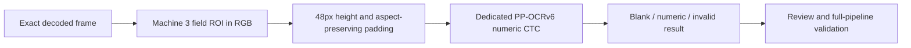

# Machine 3: dedicated RGB numerical OCR

This is a research path separate from the machine-1/2 EasyOCR fine-tune. It does
not change production model selection, ROI configuration, cached analysis or
viewer behavior. The private dated experiment contains the measured results.

This document preserves that research checkpoint. Subsequent final training
and runtime integration are recorded in [integrated OCR profiles](ocr-production-integration.md).
`--training-video combined` now supports a final fit with validation and **no**
independent test partition; it does not replace the original video-fold evidence.

## Proposed recognizer

Use PP-OCRv6 Small as the accuracy candidate and Tiny as the latency candidate.
Both process RGB-source images directly (BGR channel order at the model input).
No source-image thresholding, foreground separation or language-model prompting
is applied. These are scene-text recognizers with CTC output, not general VLMs.
Small uses PPLCNetV4 and LightSVTR; Tiny uses the smaller convolutional path.
The official model architectures and weights are documented in
[PaddleOCR's recognition module](https://github.com/PaddlePaddle/PaddleOCR/blob/main/docs/version3.x/module_usage/text_recognition.en.md)
and the [RapidOCR registry](https://github.com/RapidAI/RapidOCR/blob/main/python/rapidocr/default_models.yaml).
No published benchmark establishes which is best for these surgical overlays;
the local paired experiment is the relevant evidence.



ASP/VAC chart views require an explicit target definition: the central current
value, excluding side range labels. A chart with no central number has an empty
label. The experiment uses a separate central ROI plan at 1920×1080. Some VAC
glyphs approach the crop edges; extraction at other resolutions, alternate
layouts and automated field localization remain unvalidated. Recognition
scores are conditional on these experimental crops, not production end-to-end
pipeline scores.

## Setup and weights

Run the main project setup first. With that interpreter:

```powershell
python scripts/setup_ocr_scene.py
python tools/fetch_scene_ocr_models.py --model v6-small --output build/scene-models
```

Expected: `Scene OCR environment ready` and three `Verified` messages for ONNX,
PyTorch and dictionary files. This creates `.venv-ocr-scene`, inheriting the
project's existing PyTorch and ONNX, with additional dependencies pinned in
`config/ocr_scene_requirements.in`. It does not modify the main environment.
The downloaded model SHA-256 and dictionary SHA-256 must match
`config/ocr_scene_models.json`; mismatched existing files are refused. Downloads
remain in `.part` form until verified. All model files stay outside git.
Model source and registry snapshot are recorded in that JSON file. The
[RapidOCR license notice](https://rapidai.github.io/RapidOCRDocs/main/en/model_licenses/)
documents model attribution and redistribution requirements; source dictionaries
and local fonts have separate terms. Font files are not copied into the pack.

Linux/macOS use `.venv-ocr-scene/bin/python` below. Windows is the platform tested
for this training experiment. The environment may be removed to uninstall this
optional workflow; downloaded artifacts and private experiments are separate.

## Dataset and partitions

The root contains `labels.jsonl`, relative RGB crop paths and optional relative
training background paths. Required row fields:

```json
{"id":"example","video_id":"m3v1","machine_id":3,"frame":100,"region":"INFLOW","image":"crops/example.png","image_sha256":"actual SHA-256","label":"-0.4","status":"reviewed_numeric","human_verified":false,"time_partition":"train","background":"backgrounds/frame.jpg"}
```

`status` is `reviewed_numeric` or `reviewed_blank`; the latter requires `label`
to be an empty string. Labels contain one signed integer/decimal, not multiple
scale values. Every crop is hash-checked, paths must stay inside the dataset,
IDs must be unique, and duplicate crop content cannot cross train/val/test.
Assistant labels require explicit acknowledgement. `human_verified` is never
set true by the assistant.

Exactly two source videos are required by this particular leave-one-video-out
runner. For each run, only the chosen video's `train` rows update weights;
its `val` rows select checkpoints. `purged_gap` rows are excluded from both.
All rows of the other video are evaluated after selection. The dated experiment
uses the first 70% of each source for training, last 25% for validation and a
5% temporal gap. It includes prior diagnostic samples as well as uniformly
sampled times, low-confidence outputs and inactive/strong-background cases.

Two known videos do not constitute an untouched external acceptance set.
Architecture/augmentation comparisons consume this benchmark for research.
Final acceptance requires further source videos and independent annotation.
Temporal validation near each video's end has less value diversity than the
whole video, which limits checkpoint selection. Retain exact strings and
inspect blank hallucinations, sign/point errors and paired regressions rather
than relying on a single accuracy percentage.

## Train and export

```powershell
.venv-ocr-scene/Scripts/python tools/scene_ocr_experiment.py --data DATASET --architecture PP-OCRv6_rec_small --weights build/scene-models/v6-small.pth --dictionary build/scene-models/v6-small-dictionary.txt --training-video m3v1 --output build/scene-fit --device cuda --desktop-gpu --gpu-memory-gib 2 --accept-assistant-labels
```

Expected: one JSON progress line per epoch, followed by `Completed`. Output
includes the frozen plan and hashes, epoch history, epoch-zero validation,
selected validation, final held-out predictions, best/last PyTorch weights,
compact ONNX model and resource/timing measurements. Epoch zero is eligible;
fine-tuning is not assumed to improve accuracy. Selection uses validation
exact accuracy then CER, retaining the earlier epoch on ties. Test predictions
are written only after the selected checkpoint has been restored.

The numeric head transfers pretrained rows for blank, `+-0123456789.` and
space. All backbone parameters receive gradients at low learning rate; pretrained
batch-normalization statistics stay frozen because the training set is small.
Raw logits are captured before the inference-only head's softmax, preserving
gradients without activating its unbuilt auxiliary training branch. This is
a tested RapidOCR PyTorch-port experiment, not the official Paddle training
recipe. Tiny's source ONNX and PyTorch ports differed on some decoded samples;
retain both baseline results and compare each fine-tune against its own
pretrained PyTorch baseline as well as the source ONNX baseline.

To test generated labels on tissue backgrounds, add:

```powershell
--synthetic-count 216 --font PATH_TO_FONT.ttf --font ANOTHER_FONT.ttf
```

Only backgrounds referenced by the training rows may be used. The plan records
each generated label, background and font hash. No held-out or validation
backgrounds are admitted. This is a fixed seeded augmentation ablation, not a
claim that generic fonts match the device font. Compare real-only against
real-plus-synthetic; synthetic data can degrade accuracy.

The CUDA allocator budget does not include all driver/runtime/desktop memory.
Default CUDA mode refuses foreign compute workloads. `--desktop-gpu` is an
explicit local Windows WDDM exception that checks free capacity and reserves
headroom; it is rejected on other platforms. It never stops other processes.
No remote GPU work is submitted by these commands.

## CLI reference

`python scripts/setup_ocr_scene.py`: no flags beyond the script path.

`python tools/fetch_scene_ocr_models.py`:

| Option | Default | Meaning |
|---|---|---|
| `-h`, `--help` | — | Show every option |
| `--model` | `v6-small` | `v6-tiny`, `v6-small`, `v6-medium`, `v5-en-mobile`, `v5-server` |
| `--output` | required | Artifact directory; verified existing files are reused |

`python tools/scene_ocr_experiment.py`:

| Option | Default | Meaning |
|---|---|---|
| `-h`, `--help` | — | Show every option |
| `--data` | required | Reviewed dataset root |
| `--architecture` | required | `PP-OCRv6_rec_tiny` or `PP-OCRv6_rec_small` |
| `--weights` | required | Original full-dictionary PyTorch weights |
| `--dictionary` | required | Matching original dictionary |
| `--training-video` | required | Source ID whose temporal train/val partitions are used |
| `--output` | required | New experiment directory; existing paths are refused |
| `--accept-assistant-labels` | false | Explicit acknowledgement of non-human-reviewed labels |
| `--device` | `cpu` | `cpu` or `cuda` |
| `--gpu-index` | `0` | Physical NVIDIA GPU index |
| `--gpu-memory-gib` | `2` | PyTorch allocator budget |
| `--desktop-gpu` | false | Explicit Windows local desktop policy |
| `--epochs` | `12` | Training epochs |
| `--batch-size` | `16` | Training and evaluation batch size |
| `--lr` | `0.00003` | AdamW learning rate |
| `--seed` | `1111` | Model, shuffle and synthetic seed |
| `--threads` | `2` | PyTorch CPU threads |
| `--synthetic-count` | `0` | Additional fixed generated training samples |
| `--font` | none | Repeatable TrueType font path, required for synthesis |

Use the existing ONNX benchmark to check the exported model with an independent
runtime:

```powershell
.venv-ocr-benchmark/Scripts/python tools/benchmark_ocr_onnx.py --data DATASET --model build/scene-fit/numeric-scene.onnx --output build/scene-export-check
```

Its complete reference is in [the model comparison](ocr-model-evaluation.md).
Do not compare its all-source aggregate against held-out-only training results;
match IDs and compare only the held-out predictions for each fold.

## Helper API

These helpers support experiments; they are not production OCR interfaces.

| Signature | Behavior |
|---|---|
| `load_scene_rows(root, accept_assistant_labels=False)` | Validate and return reviewed manifest rows |
| `video_fold(rows, training_video)` | Return train/val/other-video rows; reject cross-partition duplicate content |
| `numeric_indices(dictionary)` | Return pretrained classifier row indices, including blank |
| `final_linear(model)` | Return the CTC classifier layer |
| `load_scene_model(architecture, weights, dictionary)` | Load RGB backbone with transferred compact numeric head |
| `scene_logits(model, inputs)` | Return differentiable pre-softmax logits and remove temporary hook |
| `scene_tensor(image)` | Convert PIL RGB image to padded BGR `3×48×320` tensor |
| `export_scene_onnx(model, output)` | Export checked compact probabilities model with dictionary metadata |

## Verified project lessons

### Local checkpoint: 2026-11-16

Expanded from the earlier 91 eligible diagnostic crops to 566 RGB crops from
two existing videos: 405 numeric and 161 blank. There are 68 negative and 192
decimal labels. All labels were visually reviewed by the assistant, not an
independent human. The separate central crop plan changed geometry relative to
the old diagnostic pack, so its scores cannot be compared as a pure model-only
improvement over that pack.

On the same expanded crops, pretrained numeric-masked ONNX exact counts were
462/566 for PP-OCRv5 English Mobile, 492/566 for v6 Tiny, 442/566 for v6 Small
and 411/566 for v6 Medium. Small produced 113 false-positive readings on the
161 blank crops; Tiny produced 27. The larger models were not automatically
better at rejecting empty surgical backgrounds. The v5 Server model was
evaluated only on the earlier 91 eligible crops (83/91); no expanded-set score
is claimed for it.

Eight RTX 3070 trials used Tiny/Small × real-only/real-plus-216-synthetic × two
video folds. Each used 12 epochs, batch 16, AdamW LR 3e-5 and seed 1111. Each
fold selected its checkpoint only on its training video's final temporal
validation segment. These comparisons are exploratory model selection, not
an independent final acceptance test.

| Variant | Frozen-label exact | After one label erratum, same predictions | Blank false positives |
|---|---:|---:|---:|
| Small, real only | 564/566 (99.65%) | 565/566 (99.82%) | 0/161 |
| Small, real + synthetic | 563/566 (99.47%) | 564/566 (99.65%) | 0/161 |
| Tiny, real only | 559/566 (98.76%) | 560/566 (98.94%) | 0/161 |
| Tiny, real + synthetic | 563/566 (99.47%) | 564/566 (99.65%) | 0/161 |

The erratum is a VAC crop whose visible value is **509**, initially transcribed
as **589**. It was discovered during post-experiment error review. Original
labels, plans, predictions and models remain frozen. A separate corrected
dataset and erratum record are provided; no model was retrained or reselected
after correction. This row was a training label in one fold and a test label
in the opposite fold. The corrected re-score is not a new independent test.

Small real-only had 123 gains and one regression against its own pretrained
PyTorch numeric-head baseline on the frozen labels. Its remaining corrected-label
error is `-10` read as `--10`; a scalar-format validator could reject it for
review, but no postprocessing rescue is included in the reported scores.
Small synthetic had zero paired regressions but missed two negative signs;
Tiny synthetic also had zero paired regressions but retained one missing sign
and a `30`→`80` substitution. Real-only Small is the accuracy candidate; Tiny
with synthesis is the lower-latency alternative. No universally best model or
production readiness is established by two videos.

All eight exported ONNX models reproduced their selected PyTorch checkpoint's
decoded held-out predictions: 2,264/2,264 matches across four variants × 566
out-of-fold predictions. A separate sequential CPU timing run (two ORT threads,
80 warm batch-one calls over eight crops) measured median 10.80 ms for compact
Small and 2.83 ms for compact Tiny. These exclude crop extraction, decoding,
pipeline scheduling and video I/O; desktop background load was uncontrolled.
The compact models are 12,168,350 and 2,244,659 bytes respectively. Peak PyTorch
training allocation was approximately 561 MiB for Small and 169 MiB for Tiny,
under an explicit 2 GiB allocator budget; driver/runtime memory is additional.

Artifacts include `review.html` (all crops, labels, model outputs and an error
filter), `comparison.json`, `latency.json`, `label-errata.json`, the original and
corrected datasets, all eight fits and independent ONNX checks. The recommended
family retains both real-only Small folds rather than pretending one checkpoint
has passed an untouched third-video test. Production defaults remain unchanged.

Validation: 248 maintained `check_*.py` tests passed, including 13 new scene OCR
tests. New Python files passed Ruff lint and formatting, setup was run
idempotently, and both CLI help pages were checked. The repository-wide Ruff
check still reports 207 pre-existing findings outside this change; the global
commit gate is not green and nothing was committed or pushed. No remote GPU
work was started or stopped.

The next acceptance step is additional machine-3 source videos, independently
reviewed labels, and full exact-frame pipeline checks including crop geometry,
activity/blank handling and cache behavior. Do not reuse this consumed benchmark
as a fresh test when integrating the recognizer.

Separate field geometry, blank detection and character recognition in the
evidence. A small clean numeric set can overstate accuracy by excluding empty
backgrounds and mixed chart labels. Preserve the original baseline and paired
predictions when changing crop geometry. More model parameters or synthetic
samples are hypotheses, not automatic improvements. Production adoption still
requires exact-frame pipeline regression checks and additional source videos.
