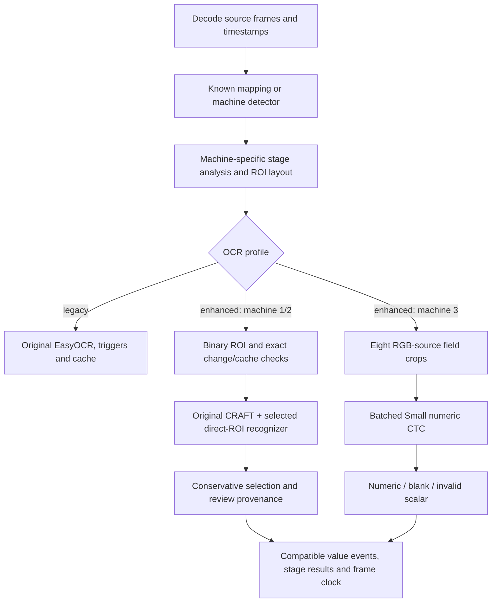

# Integrated numerical OCR profiles

The single-pass pipeline can run the original OCR route or a verified local
bundle containing the selected machine-1/2 recognizer and a dedicated machine-3
RGB recognizer. Result JSONL filenames and frame indices remain compatible with
the viewer. The repository allows the selected production weights and manifest. Training images, reviewed datasets and experimental checkpoints remain private.



## Install and run

Machine-1/2 bundles built with `--machine12-route single_numeric` use a version
2 manifest with `"machine12_route": "single_numeric"`. Earlier readers reject
the new manifest version, preventing accidental use of their dual-model route.
With this setting a changed numeric region (1–6) goes straight to the fine-tuned
recognizer. BSS uses the original recognizer once per recognition request, with
the existing empty-result retry. This preserves BSS support while its textual
states still lack a replacement evaluation. Both routes retain the event cache.
Bundles without this setting use the original conservative selection policy.
Pass `--ocr-bundle BUNDLE_DIR --ocr-profile enhanced` to test a bundle in
isolation. Machine 3 routing is independent of this option.

Use Python 3.11+ for the enhanced CPU backend and optional training environment.
The existing legacy workflow retains its prior Python support. ONNX Runtime
1.25.1 is installed by the regular setup requirements on Python 3.11+; PyTorch
and EasyOCR remain existing dependencies. Production inference does not require
RapidOCR, PaddlePaddle or the scene-training environment. CUDA scene inference
uses the packaged TorchScript model; ONNX is the CPU path.

After setup, run the doctor on the bundled weights. Use the installer when deploying a separately supplied bundle:

```powershell
python tools/install_ocr_bundle.py --source PATH_TO_BUNDLE
python tools/install_ocr_bundle.py --doctor
python run_pipeline.py --video PATH_TO_VIDEO --output-dir runs/enhanced --mode ram --ocr-profile enhanced
```

Success prints the selected profile/backend and writes analysis JSON files,
`run_stats.json`, `analysis_layout.json` and `frame_clock.json`. The doctor
verifies all artifact hashes and prints installed bundle/runtime versions.

The default CLI and library profile is `enhanced`. Explicit `auto` mode will use a complete installed bundle, otherwise
print and use the legacy route. A corrupt bundle is an error, not a silent
fallback. Explicit `enhanced` requires the bundle and reports the install
command if missing. Explicit `legacy` reproduces the original ROI, character
allowlists, machine-3 gray/debounce strategy and original recognizer. The CLI
profile default is layered as `config/ocr_profiles.json` <
`SURGERYOCR_OCR_PROFILE` < `--ocr-profile`; the built-in default is `enhanced`.
Bundle location is the default `models/trained_ocr`, then
`SURGERYOCR_OCR_BUNDLE`, then `--ocr-bundle`. Libraries may pass the options
explicitly to `run_pipeline`.

The installer uses immutable hash-named artifact files and atomically switches
the manifest last. Repeating installation reuses verified files. Install a
previous bundle to roll back, or select `--ocr-profile legacy`. To uninstall,
remove only the installed `models/trained_ocr` folder; source bundles, datasets
and analysis results are separate. Only the selected production artifacts and manifest are eligible for Git tracking.

## Model selection and final training

Machine 1/2 uses the existing selected English gen2 fine-tune
(`956552b37d502cd770e4beb7b7d1c8abe6bc4a906959d99bec03ce31e9bc3837`).
It was selected on validation before the frozen 341-case test. No test examples
were added to training for integration. See [the preserved experiment](ocr-broad-validation.md)
for the 268→333 frozen-label comparison, four raw-model regressions, conservative
routing and separately recorded annotation errata. Integration also exercises
the deployed adapter rather than assuming the experiment wrapper is equivalent.

Machine 3 uses the Small real-only architecture selected by the
[eight exploratory trials](ocr-machine3-experiments.md). The integration fit
uses the corrected dataset: 428 train crops, 120 validation crops, with the
remaining 18 temporal-gap crops excluded. It ran 12 epochs, batch 16, LR 3e-5,
seed 1111, under a 2 GiB local allocator budget. Epoch one was selected with
120/120 validation exact matches. There is **no independent test partition**
in this combined final fit. The original leave-one-video-out experiments and
post-evaluation annotation erratum remain separate and immutable. Do not report
training/development-video integration accuracy as unseen-video generalization.

Reproduce the combined scene fit after the optional scene setup:

```powershell
python scripts/setup_ocr_scene.py
.venv-ocr-scene/Scripts/python tools/scene_ocr_experiment.py --data CORRECTED_SCENE_DATASET --architecture PP-OCRv6_rec_small --weights SCENE_PRETRAINED.pth --dictionary SCENE_DICTIONARY.txt --training-video combined --output build/final-machine3 --device cuda --desktop-gpu --gpu-memory-gib 2 --accept-assistant-labels
.venv-ocr-scene/Scripts/python tools/build_ocr_bundle.py --machine12-weights SELECTED_M12.pth --machine12-evidence SELECTION_LEDGER.json --machine3-fit build/final-machine3 --output build/ocr-bundle --version YOUR_VERSION --torchscript --scene-pretrained SCENE_PRETRAINED.pth --scene-dictionary SCENE_DICTIONARY.txt
```

Linux/macOS use `.venv-ocr-scene/bin/python`. `--desktop-gpu` is Windows-only;
shared Linux training retains the strict idle-GPU checks. Packaging can omit
`--torchscript` for an ONNX CPU-only scene artifact. Tracing checks batches 1,
3 and 8 against the selected model. The bundle manifest records hashes,
training/validation counts, selection epoch, source ledger hashes, annotation
status and the absence of an independent combined-fit test. Training scripts
retain their full plans/checkpoints. No remote resources are started or stopped.

## Machine-specific behavior

Machine identity still comes from the existing mapping or fixed-label template
detector; the numerical OCR model does not guess the machine. Explicit resolved
machine IDs are passed into the ROI loader, avoiding a stale mapping during
automatic discovery. Enhanced discovery buffers retain decoded pixels through
lossless PNG. Encoded data stays within a 128 MiB RAM budget; additional frames
spill to an automatically cleaned temporary directory. Legacy discovery retains
its original JPEG encoding for comparison.

For machine 1/2, only reviewed `region1`–`region6` use the new recognizer and
policy. `region7` retains the original model. A valid original result with
confidence ≥0.95 is retained; otherwise a valid new result is preferred, with
fallback to a valid original and review flags for disagreement/invalid text.
No punctuation is invented. Both original and new recognition use the same
field allowlists and original empty-result trim retry. Standard sensitivity
keeps the original change-trigger threshold, while replacing approximate cache
matches with exact keys for those six fields. `--ocr-sensitivity exact` also
triggers on any binary pixel change, including dot/minus-sized changes; this can
substantially increase recognition work on compression noise. Standard mode
does not promise to detect changes below the original trigger threshold.
A value that reappears after a different value or deactivation starts a fresh event.

For machine 3, the eight fields are CDE, IOP, ASP, VAC, PEL, INFLOW, INCISION and
REFLUX. The current ROI calibration is for 1920×1080. Other dimensions are
rejected with a recalibration message. Source RGB is retained, with BGR channel
order at inference. No source-image thresholding, old binary cache, gray-image
debounce, CRAFT detection, geometric minus insertion or decimal insertion is
used. Only pixel-identical RGB crops reuse inference; changing fields are
batched each decoded frame. Blank output clears the previous value. Invalid
scalar text such as `--10` also clears the displayed value and is retained in
the review sidecar, rather than being repaired into an invented number.

The numeric formats are explicit: CDE has two decimal places; INCISION one;
INFLOW permits signed integer/decimal; PEL signed integer; other fields unsigned
integer. These are constraints for the reviewed device layout, not future
firmware guarantees. CTC confidence is not calibrated clinical correctness.

## Results and viewer compatibility

Each region retains `*_ocr_testing.jsonl`. Numeric event records use existing
`multi_digit_group`/`single_digit` fields and frame indices. Blank/invalid scene
values emit existing `deactivate` events. Additional source/review fields are
additive. Enhanced runs write empty region files when no value is found, clearing
stale files during an explicit reanalysis. Review records are saved separately
to `ocr_review.jsonl`; original/candidate text and the selection branch are
retained for machine 1/2. Consecutive scene values store one value-change event
with `last_observed_frame` and `observed_frame_count`, keeping GUI navigation
focused on actual changes instead of every recognition observation.

`analysis_layout.json` stores the ROI layout used by that run. The viewer
prefers saved layout/machine metadata over current global configuration.
Pre-integration machine-3 results use the preserved legacy ROI layout, so
opening an old analysis does not draw today's narrower experimental boxes.
`run_stats.json` records profile, bundle/model hashes, backend, work counters
and timings. Scene `ocr_calls` counts field images; `inference_batches` counts
batched forward passes. Scene `change_count` counts semantic events, while the
legacy counter counts image-trigger changes; these counters are not equivalent
work units. Compare annotated-frame correctness and timings separately.

Exact bounded prediction memoization also covers the legacy single-digit event
path. It reuses only an identical image shape, dtype, bytes, region and allowlist
under the same fixed model pair, preserving text, confidence, decision and event
time. It does not merge similar images. Up to 8,192 decisions per reviewed
region are retained; `exact_prediction_cache_hits` records reuse. This is a
performance optimization, not a relaxed trigger or a new learned policy.

## Compare old and new pipelines

Use a private plan containing a JSON list of:

```json
[{"video_id":"opaque-id","machine_id":3,"source_path":"ABSOLUTE_VIDEO_PATH"}]
```

```powershell
python tools/compare_pipeline_runs.py run --plan PLAN.json --output runs/pipeline-comparison --device cuda
python tools/compare_pipeline_runs.py report --plan PLAN.json --runs runs/pipeline-comparison --output runs/pipeline-report --machine12-data M12_DATASET --machine3-data M3_DATASET
```

The runner performs separate full RAM-mode legacy/enhanced passes. Existing or
incomplete output paths are refused; `--reuse-complete` explicitly reuses a
finished matching-profile pass. The report expands old cache-match events and
queries the visible value at each annotated frame, including activation,
trigger, cache and blank behavior. Different stage JSON, frame clocks or
decoded-frame counts stop reporting as a regression. Gains and losses are both
listed. `comparison.html` shows a short Chinese-labeled value comparison;
`comparison.json` retains metrics, per-video timings/work and every prediction.
Results do not overwrite the video's original analysis directory.

The larger recognizer regression can also exercise the installed production
adapter directly:

```powershell
python tools/evaluate_ocr_bundle.py --data FROZEN_M12_DATASET --output build/deployed-adapter-evaluation --device cpu --accept-assistant-labels
```

This is a crop regression excluding stateful triggers/cache. Do not present it
as a full-video result, or treat previously consumed labels as a new test set.

## CLI and API reference

Existing `run_pipeline.py` options (`--video`, `--output-dir`, `--mode`, `--force`)
remain. Added flags:

| Flag | Default | Meaning |
|---|---|---|
| `--ocr-profile auto\|legacy\|enhanced` | layered default, initially `enhanced` | Select route |
| `--ocr-bundle PATH` | env or `models/trained_ocr` | Verified local bundle |
| `--ocr-device auto\|cpu\|cuda` | `auto` | OCR device; CUDA scene needs packaged TorchScript |
| `--ocr-sensitivity standard\|exact` | `standard` | Original machine-1/2 trigger threshold or any binary pixel change; machine 3 always checks RGB every frame |
| `--machine-id 1\|2\|3` | mapping / automatic detection | Explicit known layout, without editing the video mapping |

All new tools accept `-h`/`--help`. Their other flags:

| Tool | Flags |
|---|---|
| `build_ocr_bundle.py` | Required `--machine12-weights`, `--machine12-evidence`, `--machine3-fit`, `--output`, `--version`; optional `--torchscript`, `--scene-pretrained`, `--scene-dictionary` (last two required with TorchScript) |
| `install_ocr_bundle.py` | `--source` required for installation; `--destination` defaults to local installed bundle; `--doctor` verifies without changing files |
| `compare_pipeline_runs.py run` | Required `--plan`, `--output`; optional `--bundle`, `--device auto\|cpu\|cuda` (default auto), `--sensitivity standard\|exact` (default standard), `--reuse-complete` |
| `compare_pipeline_runs.py report` | Required `--plan`, `--runs`, `--output`, `--machine12-data`, `--machine3-data` |
| `evaluate_ocr_bundle.py` | Required `--data`, `--output`; optional `--bundle`, `--split train\|val\|test` (default test), `--device cpu\|cuda` (default cpu), `--accept-assistant-labels` |

New/extended Python interfaces:

| Signature | Purpose |
|---|---|
| `run_pipeline(video_path, base_output_dir, mode="detail", force=False, ocr_profile=None, ocr_bundle=None, ocr_device="auto", ocr_sensitivity="standard", machine_id_override=None)` | Full single-pass analysis |
| `default_ocr_profile()` | Resolve config/environment CLI default |
| `default_ocr_sensitivity()` | Resolve `binary_sensitivity` / `SURGERYOCR_OCR_SENSITIVITY` CLI default |
| `configured_machine_id(mapping, video_name, override=None)` | Resolve a validated explicit/mapped layout; `None` leaves automatic discovery active |
| `numeric_summary_regions(machine_id)` / `scene_stage_changes(records, start_frame, end_frame)` | Map machine-3 IOP/ASP/VAC fields and carry observed values into stage summaries |
| `load_bundle(path=None)` | Validate schema, contained paths and every artifact SHA-256 |
| `resolve_ocr_profile(machine_id, profile="auto", bundle=None)` | Select explicit/automatic route |
| `SceneNumericOCR(root, manifest, device="cpu").recognize_regions(crops)` | Batch field→BGR crops into decisions |
| `ConservativeEasyOCR(root, manifest, machine_id, device="cpu").recognize_region(image, region, allowlist=None)` | Return selected text/confidence and retain decision provenance |
| `scalar_valid(text, region)` | Validate observed scalar/blank without rewriting it |
| `scene_input(bgr)` / `decode_scene(probabilities, characters)` | Production preprocessing and CTC decoding |
| `analysis_rois(analysis_dir, fallback, machine_id, profiles_path=None)` | Resolve the saved/legacy display layout |
| `scene_partitions(rows, training_video)` | Video fold or explicit `combined` fit without a claimed independent test |
| `FrameSpool(memory_bytes=128*1024*1024)` | Encoded frame buffer supporting `append((index, encoded))`, iteration, `len()` and `clear()` |
| `file_sha256(path)` | Stream and hash a local artifact |
| `install(source, destination)` in `install_ocr_bundle.py` | Verify and atomically install the manifest after its artifacts |
| `value_timeline(path)` / `value_at(timeline, frame)` | Reconstruct saved values, including old cache matches and blank boundaries |

Troubleshooting: missing bundle → install it or explicitly select legacy;
hash mismatch → install a verified fresh bundle instead of bypassing checks;
wrong resolution → calibrate a separate layout; invalid numerical output →
inspect `ocr_review.jsonl` and the exact frame. Never resolve an invalid result
by guessing a decimal point or sign.


## Controlled-comparison and viewer invariants

The comparison runner pins the plan's known `machine_id` for both passes using
`--machine-id`. Automatic discovery is verified separately. A first automatic
legacy pass can use JPEG-buffered frames and update a previously missing video
mapping, while the next pass uses original frames. That changes confidence
statistics even when stage boundaries agree. Do not relax stage equality to
hide this confound: preserve that discovery run and rerun the controlled
baseline with the same known layout and raw decoded input. This occurred for
machine-2 PEDAL average RMSE in the initial run; the controlled rerun matched
all stage JSON bytes, clocks and frame counts exactly.

The viewer preloads every configured numeric field, including machine-3 CDE.
Stage summaries map IOP/ASP/VAC to the correct machine-specific field names.
A constant scene value crossing a stage boundary is shown as an initial carried
value, with its original value-event `source_frame` retained; the saved OCR
observation time is not rewritten. Blank/deactivation boundaries stop that
carry, and reappearance of the same value remains a separate observation.

Missing input paths, empty input folders, unusable videos, failed model
initialization and recognition exceptions propagate as failures. The CLI does
not save success statistics for a failed recognition pass. These are tested
separately from the positive full-video comparisons. Configuration/model errors
are not swallowed as machine-detection warnings.

## Verified integration checkpoint: 2026-11-16

Bundle `2026.11.16.1` is installed locally. Machine 1/2 use the selected
fine-tuned EasyOCR recognizer with conservative selection; machine 3 uses the
dedicated RGB scene recognizer. Its combined final fit used 428 training and
120 validation crops, excluding 18 temporal-gap crops. It has no independent
test split; validation reached 120/120 at the selected first epoch.

Four complete videos (157,598 source frames) were processed with both profiles.
All four pairs have byte-identical stage JSON and frame-clock JSON, and equal
decoded frame counts. Accuracy below measures the value exposed by the complete
pipeline at annotated frames, including activation, caching and blank behavior.
It is not ground truth for every frame of the videos.

| Machine | Annotated values | Legacy exact | Enhanced exact |
|---|---:|---:|---:|
| 1 | 16 | 6 | 14 |
| 2 | 8 | 7 | 8 |
| 3 | 566 | 385 | 565 |
| Total | 590 | 398 (67.46%) | 587 (99.49%) |

There are 190 improvements and one regression. Two remaining machine-1 values
are visible zeroes suppressed by the existing stage activation rule in both
profiles, although both standalone recognizers read them correctly. The
machine-3 regression reads `2.2` as raw `22`; scalar validation rejects it and
records a review item instead of inventing a decimal. Machine-3 videos were
used during development, so these results do not establish unseen-video
accuracy. Machine-1/2 source videos were held out from training but their test
results had already been inspected during research.

The actual deployed CPU adapter also passed the frozen 341-crop machine-1/2
comparison: 270 to 333 exact, 63 gains and no regressions. This CPU baseline
differs from the earlier GPU experiment's 268 and must remain a separate result.

| Video ID | Legacy seconds | Enhanced seconds |
|---|---:|---:|
| m3v1 | 358.88 | 765.33 |
| m3v2 | 465.21 | 970.98 |
| b1-v004 | 351.43 | 555.73 |
| b2-v028 | 500.84 | 602.93 |

These desktop timings are not isolated performance benchmarks. The enhanced
route takes about 1.2–2.1 times as long; it improves recognition, not speed.
Regression verification: `python -X utf8 -m unittest discover -s tests -p
'check_*.py' -q` passed **296 tests** in 54.821 seconds. New integration modules
passed targeted Ruff checks. Repository-wide Ruff still reports 207 findings
in existing code; the repository-wide quality gate is not clean, and this
checkpoint has not been committed or pushed. Native GUI visual validation was
not repeated; viewer data loading and timeline behavior are covered by tests.

Private evidence lives in `build/ocr-integration-20261116/`, including the
self-contained `full-comparison/comparison.html`, source/model hashes,
training records, deployed-adapter scores and preserved failed experiments.
The interrupted exact-sensitivity probe and the initial automatic-discovery
baseline are not included as successful benchmark results. Preserve strict
stage equality and source verification when reproducing this comparison.
